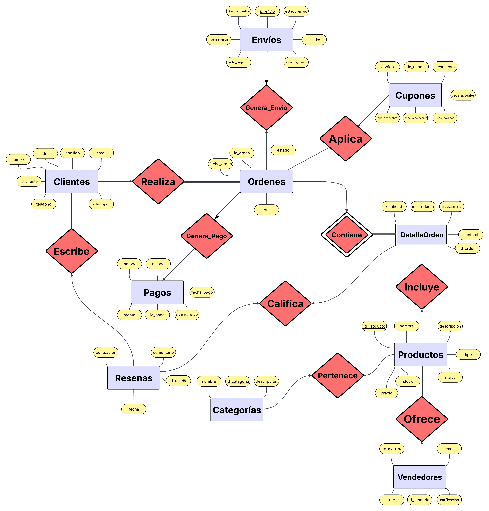

# E-commerce Database — PostgreSQL

**Proyecto académico de Base de Datos I | UTEC, 2026-1**

Diseño, implementación y evaluación de rendimiento de una **base de datos relacional para un marketplace multicategoría**. El caso de estudio toma como referencia operaciones típicas de una tienda en línea, como catálogo de productos, órdenes, pagos, envíos, reseñas y cupones.

> **Aviso:** este es un proyecto académico de simulación, realizado con datos sintéticos. El caso de estudio se inspiró en Falabella Perú, pero **no fue desarrollado para Falabella ni existe vinculación comercial o laboral con esa empresa**. No utiliza datos internos de Falabella.

## Tecnologías

- **PostgreSQL** — tablas, restricciones de integridad, índices, funciones y triggers en PL/pgSQL.
- **SQL** — consultas con JOIN, subconsultas, agregaciones y análisis con `EXPLAIN ANALYZE`.
- **Python** — generación de datos sintéticos con `Faker` y carga en PostgreSQL usando `psycopg2`.
- **Git / GitHub** — control de versiones y documentación.

## Modelo de datos

El esquema incluye **10 entidades**: `Clientes`, `Categorias`, `Vendedores`, `Productos`, `Cupones`, `Ordenes`, `DetalleOrden`, `Pagos`, `Envios` y `Resenas`.

Se usan claves primarias y foráneas, restricciones de unicidad y validación (`CHECK`), además de una clave compuesta en `DetalleOrden`.



## Reglas de negocio implementadas

El archivo `schema.sql` incluye funciones y triggers para:

- Calcular el subtotal de cada detalle de orden.
- Recalcular el total de una orden después de insertar o actualizar sus detalles.
- Descontar stock cuando una orden cambia al estado `pagada`.
- Incrementar el uso de un cupón al crear una orden que lo referencia (sujeto a su límite de usos).

**Nota técnica:** son reglas implementadas con fines académicos, no un sistema de checkout listo para producción. Por ejemplo, la validación integral de stock, concurrencia, pagos y cupones requeriría controles adicionales.

## Estructura recomendada

```text
ecommerce-database-postgresql/
├── README.md
├── .gitignore
├── schema.sql
├── generar_datos.py
├── queries/
│   ├── console_1_1k.sql
│   ├── console_1_10k.sql
│   ├── console_1_100k.sql
│   └── console_1_1m.sql
└── docs/
    ├── er_diagram.png
    └── Proyecto_2_BD_1_Grupo_3.pdf  # opcional; revisar datos personales
```

**Los archivos `dump_*.sql` no se incluyen en el repositorio:** pueden recrearse con el generador y contienen filas sintéticas con campos que parecen datos personales. Así evitamos cargar archivos muy grandes y publicar información innecesaria.

## Requisitos

- PostgreSQL (el proyecto se trabajó con PostgreSQL 18.3; puede requerir ajustes en otras versiones).
- Python 3.
- Librerías de Python `psycopg2-binary` y `Faker`.

```bash
python3 -m pip install psycopg2-binary Faker
```

## Ejecución local

1. Crear una base de datos vacía para el escenario de prueba:

   ```bash
   createdb ecommerce_1k
   ```

2. Aplicar el esquema (incluye los triggers):

   ```bash
   psql -d ecommerce_1k -f schema.sql
   ```

3. Generar datos sintéticos:

   ```bash
   python3 generar_datos.py --escenario 1k --dbname ecommerce_1k --host localhost --user postgres --password TU_PASSWORD
   ```

   Sustituye `TU_PASSWORD` por la contraseña de tu **instancia local de prueba**. El argumento `--password` del script puede quedar visible en el historial del terminal y en la lista de procesos; **no uses credenciales de producción**. Antes de usarlo fuera de un entorno académico local, es recomendable cambiar el script para usar variables de entorno o un mecanismo seguro de autenticación.

4. Verificar la carga:

   ```bash
   psql -d ecommerce_1k -c 'SELECT COUNT(*) FROM Ordenes;'
   ```

El generador acepta los escenarios `1k`, `10k`, `100k` y `1m` (cantidad objetivo de **órdenes**; las demás tablas tienen volúmenes propios). Usa una base de datos vacía por escenario. Para escenarios grandes, considera el consumo de memoria, disco y tiempo de carga.

**Importante:** `generar_datos.py` deshabilita temporalmente ciertos triggers durante la carga masiva y recalcula después algunos totales. Esta decisión permite pruebas de volumen, pero los tiempos de carga no deben interpretarse como rendimiento transaccional de producción.

## Consultas y experimentación

Los archivos de `queries/` incluyen una consulta de análisis de cupones próximos a vencer y productos sin stock, además de la creación de índices y `EXPLAIN ANALYZE`.

- Se trabajó con escenarios de **1.000, 10.000, 100.000 y 1.000.000 de órdenes**.
- El informe del proyecto documenta la metodología, planes de consulta y comparación de tiempos con y sin índices.
- **No todas las consultas mejoran con índices:** el resultado depende de la selectividad, las estadísticas y el plan de ejecución.

**Para reproducir una comparación justa**, ejecutar primero las consultas sin índices, registrar el plan y el tiempo; después crear los índices, actualizar estadísticas (`ANALYZE`) y repetir la medición. Los scripts `console_1_*.sql` incluidos crean índices directamente, por lo que **no representan por sí solos una comparación antes/después**; además, si se vuelven a ejecutar sin limpiar los índices, las sentencias `CREATE INDEX` pueden fallar porque ya existen.

## Equipo

Proyecto grupal desarrollado para el curso **Base de Datos I**, UTEC, ciclo 2026-1.

- Gabriel Saavedra Peralta
- Adrián Rojas Tejada
- Sebastián Pérez Carrasco

## Informe

El informe académico explica los requisitos, el modelo entidad-relación, el modelo relacional, la implementación, los experimentos y las conclusiones. Se puede añadir en `docs/` una copia revisada que no exponga códigos universitarios ni enlaces privados innecesarios.
